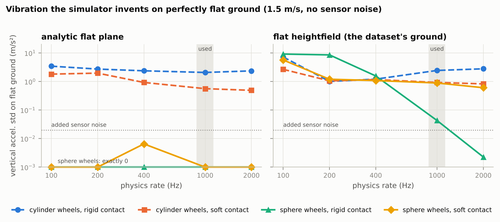
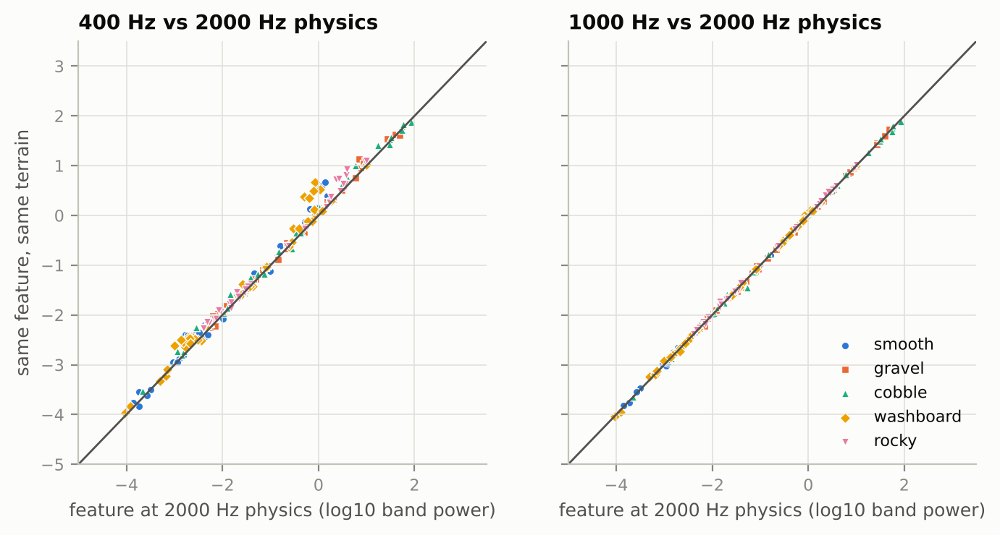
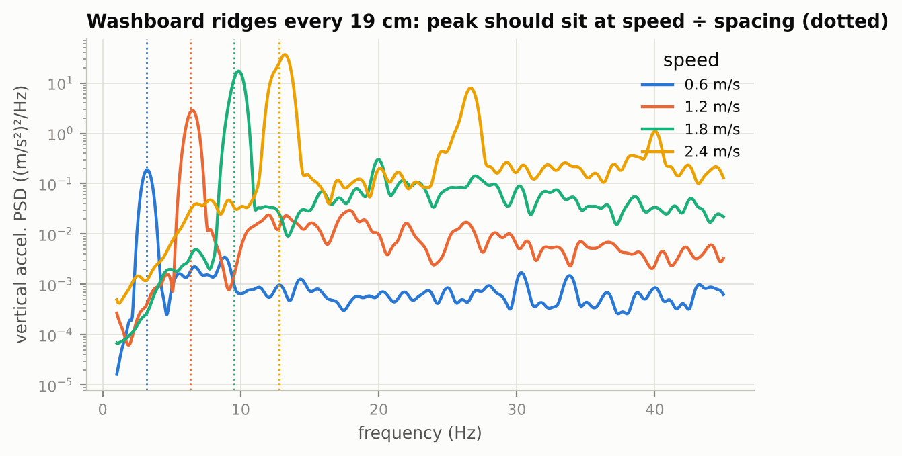
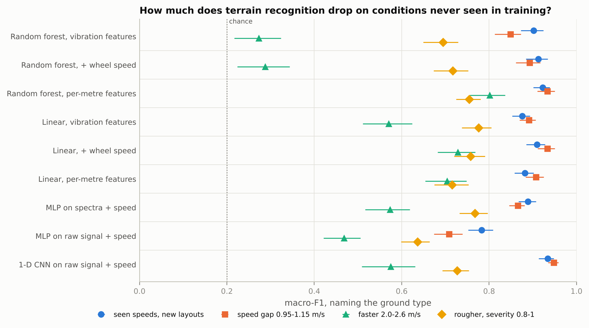
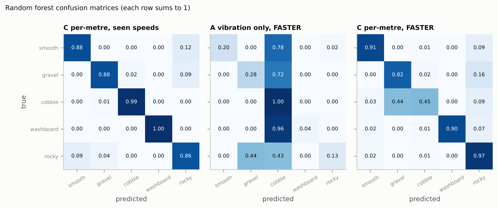

# Can a rover feel how rough the ground is?

Terrain sensing from simulated vibration: PyBullet's racecar drives over generated
ground, a simulated IMU (accelerometer + gyroscope) logs how it shakes, and
classifiers name the ground type and estimate its roughness from 1-second windows.
The question is not just *how well* this works, but **how much it degrades on
speeds and ground the model has never seen**.

## Quick start

```bash
pip install -r requirements.txt
python -m tests.test_heightfield_axes     # terrain grid lands where we think it does
python -m tests.test_imu                  # accelerometer frame and gravity sign
python -m tests.test_cnn_grad             # CNN gradients vs finite differences
python checks.py                          # simulator sanity checks -> figures/, results/checks.json
python generate.py --out data_full --runs-per-class 100   # 1,125 drives, ~60 min on 2 cores
python experiments.py --data data_full    # feature baselines -> results/baselines.json
python experiments_nn.py --data data_full # MLP + 1-D CNN     -> results/nn.json
python summarize.py --data data_full      # tables + headline figure
```

Everything is seeded (the feature baselines reproduced exactly across two full runs).
`--runs-per-class 24` gives a 270-drive pilot in ~15 min.

## What is simulated

| | |
|---|---|
| Vehicle | `racecar/racecar.urdf` from `pybullet_data` (5.9 kg, 5 cm wheels, 32.5 cm wheelbase, no suspension). Rear wheels velocity-controlled (10 N·m limit), front wheels free, steering holds the centreline. |
| Wheel contact | Wheel **collision** shapes swapped from cylinders to spheres of the same radius (mass, inertia, joints unchanged) - see *Simulator checks*. Rigid contact. |
| Physics | 1000 Hz. |
| IMU | At the chassis centre of mass. Accelerometer = R<sup>T</sup>(a − g) in the body frame (reads +9.81 m/s² upward at rest), gyroscope = R<sup>T</sup>ω. 4th-order Butterworth low-pass at 40 Hz (like a MEMS digital filter), decimated to **100 Hz**, then per-run bias + white noise (accel 0.02 m/s², gyro 0.003 rad/s). |
| Wheel encoder | Mean rear-wheel angular velocity × nominal radius, 0.5 % noise. Wheel slip makes it differ from true speed, as on a real rover. |
| Steady state | Per run: first moment the 1 s moving-average speed stays within ±5 % of the steady speed for 1 s, plus 0.5 s margin (typically 0.5-0.8 s, longer on rough ground at high speed). Only windows after that are used. |
| Windows | 1 s (100 samples × 7 channels: acc xyz, gyro xyz, wheel speed), 50 % overlap. |

### Terrain

Height grid at 1 cm spacing. Five types, each with a **severity** knob in [0, 1]:

| type | what it is | severity scales |
|---|---|---|
| smooth | long gentle undulations + fine texture | texture 0.2-0.6 mm |
| gravel | isotropic random texture, 1.5-3 cm correlation length | height std 0.8-3.2 mm |
| cobble | densely packed rounded stones, 8-12 cm apart | stone height 2.5-8.5 mm |
| washboard | periodic ridges across the track, 15-45 cm apart | amplitude 1.2-4.8 mm |
| rocky | 3-5 rocks per m², 6-15 cm radius, on light texture | rock height 5-20 mm |

**Roughness label** (per window): RMS terrain height under the two wheel tracks over the
stretch covered in that second, after removing wavelengths longer than 1 m (slopes and
gentle undulations are terrain shape, not roughness).

### Splits (fixed, assigned per run - never per window)

| split | speed (m/s) | severity |
|---|---|---|
| train / val / test_id | 0.5-0.9 and 1.2-1.6 | 0-0.65 |
| test_speed_gap | 0.95-1.15 (inside the training range, never seen) | 0-0.65 |
| test_speed_fast | 2.0-2.6 (faster than anything seen) | 0-0.65 |
| test_rougher | as train | 0.8-1.0 (rougher than anything seen) |

Plus *unseen ground type*: roughness regression trained on four types, tested on the fifth.

## Simulator checks (`python checks.py`)

**1. Flat ground must read flat.** On a perfectly flat heightfield at 1.5 m/s with no sensor
noise, vertical-acceleration std (m/s²) - everything here is simulator artefact:

| setup | 100 Hz | 400 Hz | 1000 Hz | 2000 Hz |
|---|---|---|---|---|
| stock cylinder wheels, rigid contact | 7.22 | 1.21 | 2.44 | 2.78 |
| cylinder wheels, soft contact | 2.66 | 1.17 | 0.93 | 0.82 |
| sphere wheels, soft contact | 5.67 | 1.08 | 0.89 | 0.61 |
| **sphere wheels, rigid contact (used)** | 9.14 | 1.56 | **0.043** | 0.002 |

The stock cylinder wheels chatter even on an analytic plane (2.1 m/s² at 1000 Hz),
so the artefact is in the wheel-ground contact, not the terrain. For comparison, the
added sensor noise is 0.02 m/s². 

**2. Results don't depend on the physics rate.** Same terrains simulated at 1000 and 2000 Hz:
features (log10 band powers of vertical acceleration and pitch rate) differ by
0.024 on average, vs 0.33 between different random
terrains of the same type. At 400 Hz the difference is 0.12, and on smooth ground it
exceeds the real terrain-to-terrain spread. 

**3. Physics sanity.** A parked car reads (0, 0, 9.81) m/s². Washboard ridges of spacing L at
speed v put the vibration peak at v / L Hz, within 4 % at all four speeds tested (the generator
lets ridge spacing wander by ±5 %, which accounts for the offset).


**4. Cruising speed is reached in ~0.5 s**, not 9 s: with the rear motors at the URDF's 10 N·m
limit, settling (as defined above) took a median 0.55 s and at most 0.76 s over 1,125 drives.
No drive flipped or left the track; steady speed was within 4.2 % of the command (99 % of
drives within 2.1 %).

## Results (`experiments.py`, `experiments_nn.py`, `summarize.py`)

Dataset: 1,125 drives, 18,521 training windows (500 drives); test splits 4,625-4,640 windows (125 drives each).

**Naming the ground type** - macro-F1 (chance 0.20), 95 % bootstrap interval over drives:

| model | seen speeds, new layouts | speed gap 0.95-1.15 m/s | faster 2.0-2.6 m/s | rougher, severity 0.8-1 |
|---|---|---|---|---|
| Random forest, vibration features | 0.90 (0.87-0.92) | 0.85 (0.81-0.87) | 0.27 (0.22-0.32) | 0.69 (0.65-0.73) |
| Random forest, + wheel speed | 0.91 (0.88-0.93) | 0.89 (0.86-0.92) | 0.29 (0.22-0.34) | 0.72 (0.67-0.75) |
| Random forest, per-metre features | 0.92 (0.90-0.94) | 0.93 (0.91-0.95) | 0.80 (0.76-0.84) | 0.75 (0.72-0.78) |
| Linear, vibration features | 0.88 (0.85-0.89) | 0.89 (0.87-0.91) | 0.57 (0.51-0.62) | 0.78 (0.74-0.80) |
| Linear, + wheel speed | 0.91 (0.88-0.93) | 0.93 (0.91-0.95) | 0.73 (0.68-0.77) | 0.76 (0.72-0.79) |
| Linear, per-metre features | 0.88 (0.86-0.90) | 0.91 (0.88-0.93) | 0.70 (0.65-0.75) | 0.72 (0.67-0.75) |
| MLP on spectra + speed | 0.89 (0.87-0.91) | 0.87 (0.85-0.88) | 0.57 (0.52-0.62) | 0.77 (0.73-0.80) |
| MLP on raw signal + speed | 0.78 (0.75-0.81) | 0.71 (0.67-0.74) | 0.47 (0.42-0.51) | 0.64 (0.60-0.66) |
| 1-D CNN on raw signal + speed | 0.93 (0.91-0.95) | 0.95 (0.94-0.96) | 0.57 (0.51-0.63) | 0.73 (0.69-0.75) |

**Roughness** - mean absolute error (median relative error):

| model | seen speeds, new layouts | speed gap 0.95-1.15 m/s | faster 2.0-2.6 m/s | rougher, severity 0.8-1 |
|---|---|---|---|---|
| Random forest, vibration features | 0.19 mm (13%) | 0.20 mm (15%) | 0.37 mm (33%) | 0.64 mm (27%) |
| Random forest, + wheel speed | 0.19 mm (13%) | 0.21 mm (15%) | 0.37 mm (33%) | 0.64 mm (27%) |
| Random forest, per-metre features | 0.18 mm (13%) | 0.18 mm (12%) | 0.24 mm (16%) | 0.64 mm (27%) |
| Linear, vibration features | 0.31 mm (23%) | 0.27 mm (19%) | 0.40 mm (32%) | 0.62 mm (22%) |
| Linear, + wheel speed | 0.31 mm (23%) | 0.27 mm (19%) | 0.41 mm (33%) | 0.62 mm (22%) |
| Linear, per-metre features | 0.31 mm (25%) | 0.31 mm (23%) | 0.32 mm (26%) | 0.59 mm (23%) |
| MLP on spectra + speed | 0.27 mm (19%) | 0.27 mm (19%) | 0.40 mm (34%) | 0.55 mm (23%) |
| MLP on raw signal + speed | 0.30 mm (21%) | 0.31 mm (21%) | 0.62 mm (41%) | 0.69 mm (27%) |
| 1-D CNN on raw signal + speed | 0.19 mm (13%) | 0.18 mm (12%) | 0.53 mm (31%) | 0.50 mm (19%) |

**Roughness on a ground type never seen in training** (random forest, vibration features; trained on the other four types, tested on new layouts of the held-out type):

| held-out type | true mean | error, type seen | error, type never seen |
|---|---|---|---|
| smooth | 0.32 mm | 0.05 mm (12%) | 0.24 mm (66%) |
| gravel | 1.44 mm | 0.20 mm (12%) | 0.37 mm (24%) |
| cobble | 0.97 mm | 0.32 mm (25%) | 0.48 mm (38%) |
| washboard | 1.74 mm | 0.13 mm (6%) | 0.97 mm (62%) |
| rocky | 1.15 mm | 0.27 mm (20%) | 0.33 mm (23%) |




### Models

* **Feature sets** (`rover/features.py`): **A** vibration statistics and band powers in Hz;
  **B** = A + wheel-encoder speed; **C** "per-metre": spectra converted to bumps per metre
  using the wheel speed, acceleration converted to displacement, plus shape statistics.
* **Random forest** (400 trees) and **linear** (logistic / ridge) on each feature set.
* **MLP** (256-128 units) on raw windows or on log spectra, plus speed.
* **1-D CNN** (3 conv layers, ~10 k weights, `rover/cnn.py`) on the raw 6-channel window, plus speed.
* Neural models: early stopping on the `val` split, 3 seeds, metrics averaged over seeds.
* All intervals: 95 % bootstrap over drives (windows from one drive are resampled together).

### What the results say

1. **In familiar conditions it works.** One second of shaking names the ground type with
   macro-F1 0.88-0.93 (the raw-signal MLP is the exception at 0.78), and the best models
   estimate roughness to 0.18-0.19 mm, about 13 %.
2. **Unseen speeds inside the training range cost little** (0.85-0.95 for every model except
   the raw-signal MLP, 0.71).
3. **Faster than ever seen is where models break.** The random forest on vibration features
   falls from 0.90 to 0.27, close to chance. It calls 78 % of all windows "cobble", including
   96 % of washboard windows, because faster driving shakes harder and cobbles were the
   hardest shaking it had seen. **Giving it the speed does not help (0.29)**: trees cannot
   extrapolate beyond the speeds they were trained on.
4. **A neural network does not fix this by itself.** The 1-D CNN is the best model on seen
   speeds (0.93) and on the speed gap (0.95), but drops to 0.57 (0.51-0.63) when faster,
   even though it is given the speed. The MLP on spectra also reaches 0.57.
5. **Normalising per metre does most of the fixing.** The random forest on per-metre features
   keeps 0.80 (0.76-0.84) at unseen higher speeds, a 12-point drop from 0.92, against 63
   points for raw vibration features. The linear model given the speed is next (0.73). The
   remaining error is mostly cobble mistaken for gravel (44 % of cobble windows). Roughness
   at higher speeds: 0.24 mm (16 %) with per-metre features, vs 0.37 mm (33 %) without and
   0.53 mm (31 %) for the CNN.
6. **Rougher ground than ever seen costs every model** (0.64-0.78 macro-F1). Random-forest
   roughness estimates saturate: on the roughest 10 % of those windows (true mean 3.6 mm)
   they predict 2.3 mm. The CNN extrapolates roughness best here (0.50 mm, 19 %).
7. **A ground type never seen in training:** roughness transfers for rocky (20 % → 23 %) and
   gravel (12 % → 24 %), less well for cobble (25 % → 38 %), and fails for washboard
   (6 % → 62 %; 43 % with per-metre features): periodic ridges shake the car in a way none
   of the random textures do. Smooth goes 12 % → 66 %, though that is 0.24 mm in absolute terms.

**Answer to the question.** Yes, a rover can tell ground types apart and estimate roughness
from how it shakes. The weak spot is **speeds faster than any in training**. Models that read
vibration per second lose 35-70 % of their macro-F1 there, including the CNN and MLPs that are
given the speed (36-40 %). The one exception is a linear model given the speed (20 % loss,
0.73). Expressing vibration per metre travelled instead of per second does best: a random
forest on per-metre features keeps 0.80, a 13 % loss.

**Caveats.** Feature baselines are deterministic (two full runs gave identical numbers);
neural models vary little across seeds (e.g. CNN at higher speed: 0.54-0.60). The MLP on
spectra and some CNN roughness models were still improving slightly at their epoch limit,
so they may be a little undertrained. Hand-made feature models use one random-forest seed.
Pilot results (270 drives) are in `results/pilot/` and agree in direction with these.

## Limitations

Simulation only. The racecar has no suspension and rigid wheels, so absolute vibration
levels are harsher than on a real rover; real tyres, suspension, frame resonances, IMU
mounting, temperature drift and sensor clipping are not modelled. Sphere wheel contact
samples the ground along a line rather than a 4.5 cm-wide strip. The "unseen speed"
results are the robust part of this study; absolute accuracies will not carry over to a
real vehicle.

## Repository layout

```
rover/terrain.py      terrain generators + roughness label
rover/sim.py          PyBullet driving loop, IMU model, settling detection, windowing
rover/features.py     feature sets A / B / C
rover/cnn.py          small 1-D CNN in plain NumPy (no deep-learning library needed)
checks.py             simulator sanity checks
generate.py           dataset with fixed run-level splits
experiments.py        feature baselines (random forest, linear), bootstrap CIs, figures
experiments_nn.py     neural baselines (MLP on raw / spectra, 1-D CNN)
summarize.py          results tables + headline figure from the saved JSON
export_hf.py          Parquet export for the Hugging Face Hub (needs pyarrow)
hf_dataset_card.md    README for the Hugging Face dataset page
tests/                heightfield axes, IMU frame/gravity sign, CNN gradients
```
